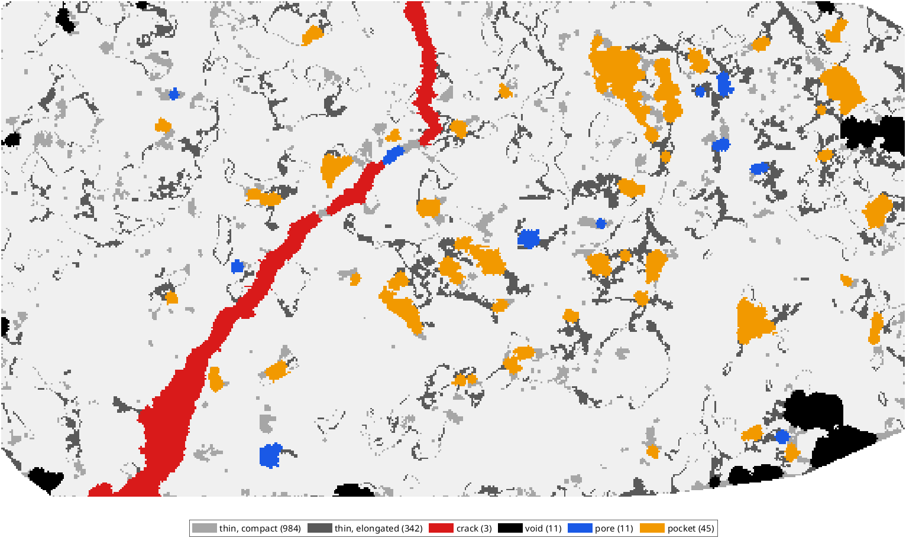
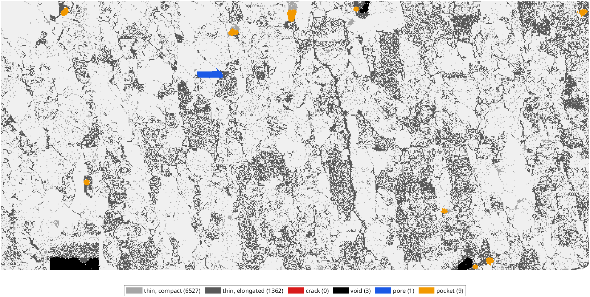
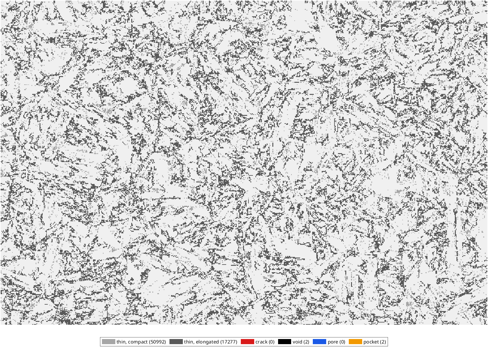
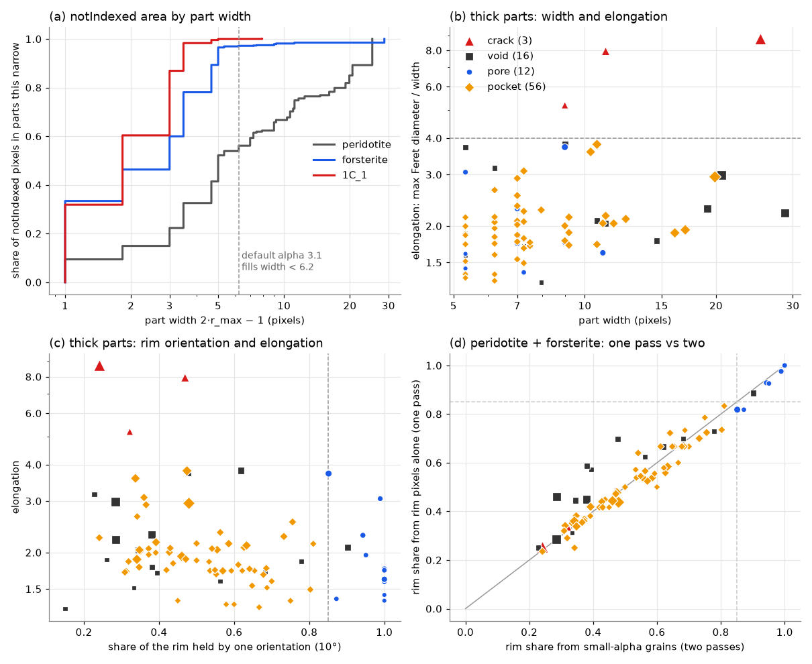
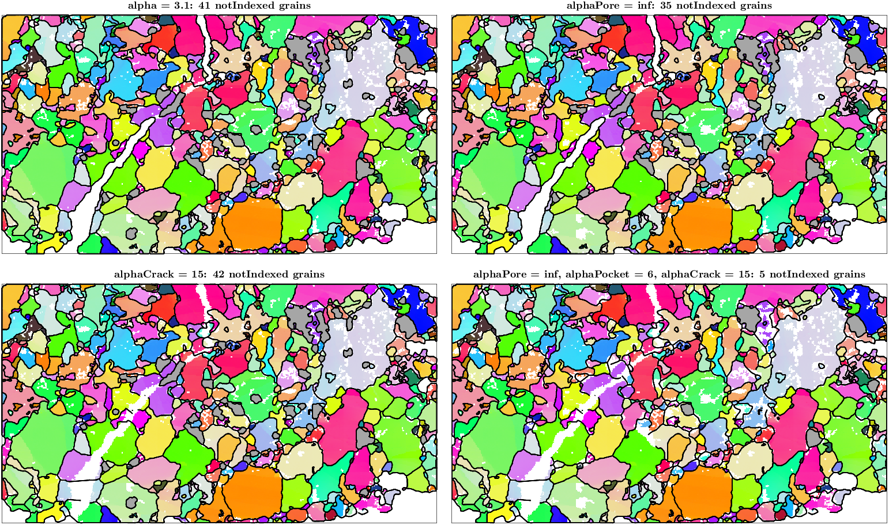

# Kinds of notIndexed regions in calcGrains

An investigation of how `calcGrains` could tell noise, pores, pockets, cracks and voids apart
and close each with a parameter of its own. Measured on `mtexdata peridotite`,
`mtexdata forsterite` and 1C_1 (`~/mtex/data/1C_1.ctf`, 1377 × 1837 pixels), MATLAB R2024b.
The measurement code and the figures are in
[`notindexed-classification/`](notindexed-classification/). The design recommended below is
implemented: `calcGrains` takes `'alphaPore'`, `'alphaPocket'` and `'alphaCrack'`,
`EBSD/notIndexedKinds` returns the kinds, and `GrainReconstructionCracks.m` shows them.

## Summary

- The closing in `spatialDecompositionGrid` leaves open exactly the opening of the notIndexed
  pixels by the disk of radius `alpha`. The connected components of what stays open are the
  **thick parts**; everything else is thin and is filled as noise. Only the thick parts need a
  kind.
- Thin parts carry 52 % of the notIndexed pixels on peridotite, 96.5 % on forsterite and
  99.97 % on 1C_1. The closing at the default `alpha` 3.1 leaves 62, 9 and 81 thick parts open.
- Three features separate the kinds on these maps:
  - **crack**: Feret² / area ≥ 5. The three parts of the peridotite crack lie at 7.4–14.1, every
    other thick part at ≤ 4.3.
  - **void**: touching the edge of the scan. Width does not separate voids from pockets.
  - **pore**: the share of the rim held by one orientation, ≥ 0.85. It is continuous, so the
    threshold decides the count.
- Only one crack exists in the three maps.
- **The design**: the closing radius becomes a property of the kind of the cell. `calcGrains`
  takes `'alphaPore'`, `'alphaPocket'` and `'alphaCrack'`, each defaulting to `alpha`; after the
  closing at `alpha`, the thick parts are classified and every part is closed once more with the
  radius of its kind, through the existing `closedAt`. A prototype of 100 lines does this on the
  grid and the `'delaunay'` path.
  - With the defaults the result is bitwise identical on all three maps and on both paths.
  - Each parameter acts only on its kind: pocket radii leave the crack and the outside area
    untouched, crack radii leave pores and pockets.
  - `alphaCrack` 15 bridges the whole peridotite crack, with 42 notIndexed grains kept; the area
    outside all grains drops from 10.7 % to 5.9 %, lower than the 7.3 % that `alpha` 16.1 reaches
    while keeping no notIndexed grain at all.
  - The classification costs 0.04 s on peridotite and 0.06 s on 1C_1.
- A public function returning the kinds, and a `'kinds'` option to pass them back, let the user
  inspect and override the classification.

## How alpha acts now

`closeAt` closes the indexed cells with a disk of radius `alpha`. A notIndexed pixel stays open
exactly when some disk of that radius lies inside the notIndexed set and covers it, so the open
pixels are the opening of the notIndexed mask by that disk. A region whose maximum inscribed
radius is below `alpha` vanishes. A wider region keeps its opening, and its thin arms and necks
are filled. `alpha` is a width threshold, applied per pixel neighbourhood rather than per region.

## Measuring the parts

The code is [`niParts.m`](notindexed-classification/niParts.m), with
[`runFeatures.m`](notindexed-classification/runFeatures.m) as the driver. It uses the Image
Processing Toolbox and is for the figures only.

1. Grid the map. The scan is the convex hull of the indexed pixels, as in the fill model, and
   its notIndexed pixels form the mask.
2. Split the mask into parts.
   - **thick** = the opening by a disk of radius r0 = 3 pixels, the default `alpha` 3.1 rounded
     down;
   - **thin** = the rest. A thin piece lying within r0 of a thick part of the same region is
     that part's rim and joins it.
3. Segment the map with `calcGrains(ebsd,'angle',10*degree,'alpha',1.1)`.
4. Measure every part:
   - area;
   - width 2·r_max − 1, where r_max is the maximum of the Euclidean distance transform;
   - maximum Feret diameter and skeleton length;
   - border contact;
   - the indexed rim pixels (8-neighbours), their grains, and those grains merged when their
     mean orientations are within 10°. `oriShare1` is the share of rim contacts held by the
     largest merged group.

The classes ([`classifyParts.m`](notindexed-classification/classifyParts.m)) are applied in
priority order:

1. thin → **noise**;
2. Feret ≥ 4·width → **crack**;
3. touches the border → **void**;
4. `oriShare1` ≥ 0.85 → **pore**;
5. otherwise → **pocket**.

The class maps also shade thin parts darker when they are elongated (Feret ≥ 4·width).

| map | pixels | notIndexed in scan | parts | thin share of notIndexed | thick parts | crack | void | pore | pocket |
| --- | ---: | ---: | ---: | ---: | ---: | ---: | ---: | ---: | ---: |
| peridotite | 163 800 | 30 637 | 1 396 | 52.2 % | 70 | 3 | 11 | 11 | 45 |
| forsterite | 245 952 | 58 442 | 7 902 | 96.5 % | 13 | 0 | 3 | 1 | 9 |
| 1C_1 | 2 529 549 | 612 661 | 68 273 | 99.97 % | 4 | 0 | 2 | 0 | 2 |

The prototype inside `calcGrains` below takes its parts from the closing itself, at radius 3.1
and with the closing's lateral companions, and counts the bays at the map edge as parts too.
It finds 62 parts on peridotite (6 pores, 43 pockets, 3 crack parts, 10 voids), 9 on
forsterite and 81 on 1C_1 (1 pore of 37 cells, 69 pockets, 11 voids).

## The class maps



On peridotite:
- the crack is one red part from the bottom edge to the top edge, through its narrow upper part;
- pockets (orange) sit along the crack in its middle, and one pore (blue) touches it there;
- voids (black) are the regions cut by the map edge;
- the dark grey thin networks between the grains are elongated but at most 5 pixels wide.



Forsterite's notIndexed pixels are almost all thin:
- speckle, and grain-boundary networks;
- thin straight cracks running vertically, at most 3 pixels wide;
- two rectangular unscanned blocks at the bottom edge, classed as voids;
- one horizontal bar classed as a pore, which is a scan artefact rather than a pore.



1C_1 is a dense network of notIndexed lines one to three pixels wide along the boundaries,
17 277 of its parts elongated. The default closing fills all of it.

## The feature space



- (a) The share of the notIndexed pixels in parts up to a given width. The default `alpha`
  already decides almost everything on forsterite and 1C_1. Only on peridotite does half of the
  notIndexed area lie in parts wider than the closing.
- (b) Thick parts of all three maps, width against elongation. The cracks stand apart above 5,
  every other part is below 3.9. Width alone separates nothing: pockets reach 20 pixels, the
  crack's lower part 25, voids 5–29.
- (c) The rim orientation share against elongation. Pores gather at 1.0, but parts spread
  continuously from 0.15 to 1. A pore next to a second grain of a different orientation moves
  below any threshold.
- (d) The rim share from small-alpha grains against the share from the rim pixels alone. The
  two agree closely: on 69 of 70 peridotite parts and 12 of 13 forsterite parts at the 0.85
  threshold, correlation 0.98 on peridotite. Where they differ, the one-pass value is higher on
  voids, whose rims are short and broken by the map edge. The rim-pixel test needs no
  segmentation, which is what makes the one-pass design below possible.

### Where the kinds overlap

- **Thin elongated networks vs cracks.** Elongation alone calls the boundary networks of 1C_1
  and forsterite cracks: 17 277 and 1 362 parts. Only width keeps them apart, so the crack test
  must apply to parts wider than the noise closing. With a small `alpha` such as 1.1, the
  networks become thick and the crack test misfires on them.
- **Wide crack vs pocket.** Width cannot separate them; elongation can. Where a crack widens
  into a pocket, the opening cuts the region at its necks: the widenings along the peridotite
  crack become pockets of their own, and the narrow stretches between them stay crack. That
  matches what a user wants, unless the widening is the crack itself.
- **Intergranular crack vs chain of pockets.** A chain of compact pockets joined by necks
  narrower than r0 is several pockets plus thin necks. Like a crack, it is bridged at the necks
  only. The upper-right cluster of peridotite is such a chain. No feature measured here tells it
  apart from a crack that runs along boundaries and widens at triple junctions.
- **Pore vs pocket.** There is no wide gap in the rim share, see (c). Most pores lie at
  ≥ 0.94, but the class boundary is a choice. `isInclusion` on the default reconstruction counts
  5 notIndexed grains enclosed by one grain, while the 10° rim share counts 12 in the
  measurement and 6 in the prototype. The rim share merges pieces of one orientation that a
  small-alpha segmentation splits.
- **Void vs crack mouth.** The crack touches both map edges. Testing the crack before the
  border keeps it a crack, so a crack mouth is bridged like the rest of the crack.
- **Pockets on a crack.** Once the crack is bridged, the pockets lying in it are enclosed by
  one grain: `isInclusion` counts 5 such notIndexed grains before and 7–8 after bridging. Whether
  they are pores is decided before the bridging.
- **Mixed regions.** On peridotite, 5 of the 43 regions with a thick part hold more than one
  thick class: one region holds crack, pocket and pore. 42 of the 43 also have thin parts.
  Classifying whole regions would fail on these.

### Sensitivity to the opening radius

| r0 | peridotite: thick / crack (pixels) / void / pore / pocket | forsterite: thick / crack / void / pore / pocket |
| --- | --- | --- |
| 2 | 157 / 9 (6 037) / 19 / 22 / 107 | 84 / 5 / 6 / 18 / 55 |
| 3 | 70 / 3 (4 486) / 11 / 11 / 45 | 13 / 0 / 3 / 1 / 9 |
| 4 | 37 / 3 (4 184) / 9 / 3 / 22 | 6 / 0 / 2 / 0 / 4 |
| 6 | 15 / 1 (2 008) / 5 / 0 / 9 | 2 / 0 / 2 / 0 / 0 |

The crack stays one class for r0 2–4. At r0 = 6 its narrow necks cut it, and only its lower part
remains. Pores and pockets shrink quickly with r0, because the opening radius is also the size
below which they count as noise.

## The design: a closing radius per kind

The closing radius becomes a property of the kind of the cell. `alpha` stays the radius for
noise, and three options give pores, pockets and cracks a radius of their own:

```matlab
grains = calcGrains(ebsd,'alpha',3.1,'alphaPore',inf,'alphaPocket',6,'alphaCrack',15)
```

A pore or pocket is filled when it is narrower than twice its radius, otherwise its core stays
open; a crack is bridged wherever it is narrower than twice `alphaCrack`; `inf` fills the kind
whole. A radius equal to `alpha` changes nothing, and that is the default of all three.

[`perKindRadius.diff`](notindexed-classification/perKindRadius.diff) is the prototype, applied
only for the measurements below. In `spatialDecompositionGrid`, after `closeAt`:

1. The thick parts are the connected components of `~closedP & inScanP`, labelled with the
   stencil graph as `floodFillBorder` already does.
2. Per part: cell count; border contact from `binaryDilate(~inScanP)`; the Feret diameter from
   the convex hull of the cell positions, and Feret² / area.
3. The rim: every indexed cell next to the part, one contact per part and cell. Adjacent rim
   cells are joined when `gbc.eval` connects their pixels, and the resulting pieces are joined
   once more where their first cells connect. The share of the rim in the largest piece is the
   pore test. The criterion is the one the segmentation uses, so `'angle'` and the other
   criterion options govern the pore test as well.
4. Kind priority: Feret² / area ≥ 5 → crack; border → void; rim share ≥ 0.85 → pore; else
   pocket.
5. For each kind whose radius differs from `alpha`, the cells of that kind are closed again
   with the kind's radius: `closedAt(x, ..., diskOffsets(alphaK*dxy))`, `true` for `inf`, and
   on the `'delaunay'` path `rMin(x) <= alphaK*dxy`. The result is ORed into `closedP`.
6. The corridor rule, which reopens filled cells that join a hole to the outside, skips the
   cells closed by their kind.

Everything after `closedP` is unchanged: the exterior flood fill, the site-less filled cells,
the Voronoi decomposition and `straightenInFill`.

Three things in the file have to move for this:
- the padding of the raster is sized from the largest finite radius, not from `alpha`;
- the `'delaunay'` path calls `alphaComplexMask` with that largest radius, so that `rMin` is
  known up to it, and tests `rMin <= alpha*dxy` for the base closing;
- the convex hull of the scan is computed before the branch on `'delaunay'`, since both paths
  need it.

`calcGrains` passes its criterion along: `spatialDecompositionGrid(ebsd,lat,varargin{:},'gbc',gbc)`.

### The result on peridotite

All runs use `'angle',10*degree,'minPixel',5` and `alpha` 3.1. "Filled" counts the cells the
kind's radius closed beyond the base closing.

| radius | grains | notIndexed grains | enclosed by one grain | outside all grains | filled cells |
| --- | ---: | ---: | ---: | ---: | ---: |
| none (default) | 575 | 41 | 5 | 10.7 % | 0 |
| alphaPore inf | 569 | 35 | 0 | 10.7 % | 477 |
| alphaPocket 4 | 550 | 21 | 5 | 10.7 % | 2 266 |
| alphaPocket 6 | 538 | 11 | 6 | 10.6 % | 4 204 |
| alphaPocket 10 | 535 | 8 | 5 | 10.1 % | 5 492 |
| alphaPocket 20 | 530 | 6 | 5 | 10.1 % | 6 403 |
| alphaCrack 5 | 570 | 44 | 7 | 9.7 % | 1 053 |
| alphaCrack 7 | 566 | 42 | 6 | 8.3 % | 2 077 |
| alphaCrack 10 | 566 | 43 | 8 | 6.0 % | 2 683 |
| alphaCrack 15 | 563 | 42 | 7 | 5.9 % | 4 161 |
| alphaCrack 25 | 563 | 42 | 7 | 5.9 % | 4 161 |
| alphaPore inf, alphaPocket 6, alphaCrack 15 | 519 | 5 | 1 | 5.9 % | 8 842 |
| alpha 16.1 alone | 510 | 0 | 0 | 7.3 % | — |

- The pocket radii change the pockets alone: the crack, the pores and the outside area stay.
- The crack radii change the crack alone: 4 161 cells is the whole crack, reached at 15. The
  outside area falls to 5.9 % because the crack and its mouth at the bottom edge no longer count
  as outside. `alpha` 16.1 leaves 7.3 % outside, the border bays it cannot bridge, and no
  notIndexed grain.
- With all three set, 519 grains remain, against 510 at `alpha` 16.1, and the five notIndexed
  grains are the pockets wider than 12 pixels.

On the `'delaunay'` path (`alpha` 2.2): default 695 grains and 138 notIndexed; `alphaCrack` 7
bridges 3 272 cells, 15 bridges 5 160 and leaves 8.1 % outside; all three radii give 523 grains
and 7 notIndexed.



The grains on the two sides of the crack join wherever their misorientation is below 10°, along
straight boundaries. The pockets stay (grey), and the voids at the right edge stay outside.

### Identity and cost

- With every radius equal to `alpha`, the kind loop is skipped. Forcing the classification
  (`'classify'`) gives a `grainId` identical to the default on peridotite, forsterite and 1C_1,
  and on the `'delaunay'` path.
- The classification takes 0.04 s on peridotite, 0.03 s on forsterite and 0.06 s on 1C_1,
  where `calcGrains` takes 28–30 s. It touches the 62 / 9 / 81 thick parts and their rims only.
- The second closing costs by the cells of the kind times the disk area: `alphaCrack` 25 on the
  4 161 crack cells adds 1.3 s on peridotite, `alphaCrack` 15 adds 0.5 s. A bounding box per part
  would cut that; it was not needed here.
- The `minPixel` loop culls grains between decompositions. Their pixels become notIndexed and
  are classified in the next decomposition like any other, so the loop needs no change.

### A latent bug found on the way

`closedAt` with a single cell builds `x + o` as a row, so `unique` returns a row and the result
has one value per disk offset instead of one per cell. The corridor rule hits it whenever its
corridor has exactly one cell; `'alphaPocket',6` on peridotite does. The fix is
`unique(reshape(x + o,[],1))`, included in the diff. On develop the same corridor can occur
with a plain `alpha`.

## Alternatives

### Two passes, with a fill mask

`calcGrains` segments at a small `alpha`, classifies the parts against those grains, builds a
mask of the pixels to fill, and runs again with the mask ORed into `closedP`. Measured on 1C_1
as a prototype: 17–18 s for the first full pass, 8–9 s for the parts and their rim grains, 28 s
for the second pass, 55 s in all against 26.6 s. A first pass that only labels the grains would
cost about 5 s. The pore test by grains and the pore test by rim pixels agree on 81 of 83 thick
parts, and the two-pass version depends on the `alpha` of its first pass. Nothing in the result
needed the first segmentation.

### Post-processing only

`calcGrains` stays as it is and pores are merged afterwards, as `GrainReconstructionCracks.m`
does with `merge(grains,'inclusions',~grains.isIndexed)`. That handles pores and nothing else:
bridging a crack needs the decomposition to put boundaries through it.

### Per-kind radii without a public classification

The internal half of the design alone. The user cannot see why a region was or was not
bridged, and cannot correct a pocket taken for a crack.

## Recommendation

The per-kind radius, with:
- `calcGrains` options `'alphaPore'`, `'alphaPocket'` and `'alphaCrack'`, radii in pixels like
  `alpha`, each defaulting to `alpha`, so the output does not change until one is set;
- a public function, for example `[kinds,parts] = notIndexedKinds(ebsd,'alpha',3.1)`, returning
  the kind of every pixel and a table of the thick parts with their features, computed by the
  very code `calcGrains` uses;
- a `'kinds'` option on `calcGrains` taking that per-pixel kind back, edited or not. A part takes
  the kind of its pixels; a part with no pixel in the map, or one that appears only after
  `minPixel` culling, keeps the computed kind;
- in `GrainReconstructionCracks.m`, a section that plots the kinds, then bridges the crack with
  `'alphaCrack'` and fills the pores with `'alphaPore',inf`.

Sharing the code between `calcGrains` and the public function means moving the closing
(`closeAt`, `diskOffsets`, `binaryDilate`, `floodFillBorder`) and the classification out of
`spatialDecompositionGrid` into private files of their own.

## Open decisions

1. **Defaults.** Keep every radius at `alpha`, so nothing changes, or make `'alphaPore',inf` the
   default, since a pore enclosed by one grain is part of that grain?
2. **Names.** `'alphaPore'`, `'alphaPocket'`, `'alphaCrack'`, or one vector
   `'alpha',[noise pore pocket crack]`? Radii in pixels as `alpha`, or widths in the scan unit?
3. **Thresholds.** Feret² / area ≥ 5 and rim share ≥ 0.85: fixed in the code or options? The
   crack threshold rests on one crack. More maps with cracks are needed before fixing it.
4. **Voids.** Border contact is the only void test, and a crack mouth at the border is a crack.
   Should a void get a radius too, or should a very wide interior region count as a void?
5. **Pockets on a bridged crack.** They become enclosed by one grain after the bridging. Leave
   them as pockets, or classify pores after the crack is bridged?
6. **Chains of pockets.** Leave them as pockets bridged at their necks, or add a test for
   aligned chains?
7. **Shape of the classification.** A per-pixel integer or categorical, a table of parts, or
   both.

## Files

- [`perKindRadius.diff`](notindexed-classification/perKindRadius.diff): the prototype in
  `spatialDecompositionGrid` and `calcGrains`.
- [`figKinds.m`](notindexed-classification/figKinds.m): the four-panel figure, needs the diff.
- [`niParts.m`](notindexed-classification/niParts.m): the parts and their features for the
  measurement, with the Image Processing Toolbox.
- [`classifyParts.m`](notindexed-classification/classifyParts.m): the candidate classes.
- [`rimShare.m`](notindexed-classification/rimShare.m): the rim test from the rim pixels alone.
- [`runFeatures.m`](notindexed-classification/runFeatures.m),
  [`figClasses.m`](notindexed-classification/figClasses.m),
  [`classMap.m`](notindexed-classification/classMap.m) and
  [`figFeatures.py`](notindexed-classification/figFeatures.py): the measurements and the
  figures.
