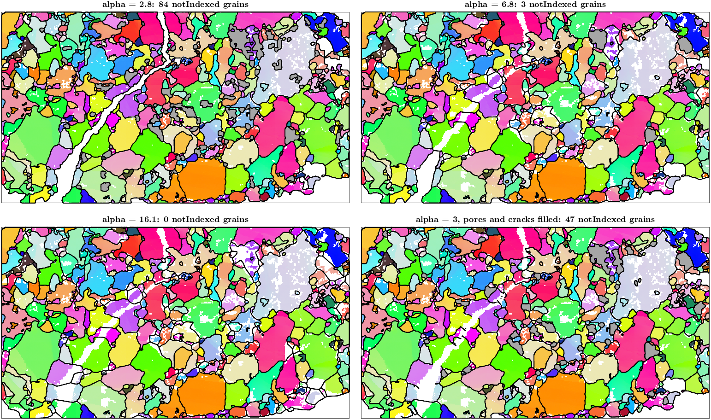

# Kinds of notIndexed regions in calcGrains

An investigation of how `calcGrains` could tell noise, pores, pockets, cracks and voids apart
and treat each with its own parameter. Measured on `mtexdata peridotite`, `mtexdata forsterite`
and 1C_1 (`~/mtex/data/1C_1.ctf`, 1377 × 1837 pixels), MATLAB R2024b. Nothing in the library is
changed; the prototype code and the figures are in [`notindexed-classification/`](notindexed-classification/).

## Summary

- The closing in `spatialDecompositionGrid` keeps exactly the opening of the notIndexed pixels
  by the disk of radius `alpha`. Splitting every notIndexed region into its **thick** parts
  (the opening) and its **thin** parts (the rest) therefore reproduces the current mechanism, and
  the thick parts are the only ones where a kind needs to be decided.
- Thin parts carry 52 % of the notIndexed pixels on peridotite, 96.5 % on forsterite and
  99.97 % on 1C_1. On 1C_1 only 4 of 68 273 parts are thick. Any classification touches few
  parts.
- Among the thick parts, three features separate the kinds on these maps:
  - **crack**: elongation, max Feret diameter / width ≥ 4. The three crack parts lie at 5.2–8.7,
    every other thick part at ≤ 3.8. Feret² / area separates them equally (5.7–14.9 against ≤ 4.6)
    and needs no distance transform.
  - **void**: touching the edge of the scan. Width does not separate voids from pockets: border
    parts are 5–29 pixels wide, interior pockets up to 20.
  - **pore**: the share of the rim held by one orientation (10°). It is continuous, not
    bimodal: 12 parts lie at ≥ 0.85, the gap is only 0.81 → 0.85. The threshold decides the
    count.
- Only one crack exists in the three maps, so the crack threshold rests on three parts of one
  crack.
- A prototype that fills the pores and the crack up to 30 pixels and keeps everything else
  bridges the peridotite crack and keeps 47 notIndexed grains. Alpha 16.1 bridges the crack but
  keeps 0 notIndexed grains.
- The pore test needs no first segmentation. Reading the rim pixels directly agrees with the
  two-pass test on 69 of 70 peridotite parts and 12 of 13 forsterite parts (correlation 0.98 on peridotite) and takes 0.27 s.
- **Recommendation**: design B below. `calcGrains` gets a fill mask in place of the single
  radius. The mask is built from the closing's own thick parts and their rim pixels, in one pass,
  at under a second on 1C_1. A public function returns the classification so it can be checked
  and overridden.

## How alpha acts now

`closeAt` closes the indexed cells with a disk of radius `alpha`. A notIndexed pixel stays open
exactly when some disk of that radius lies inside the notIndexed set and covers it, so the open
pixels are the opening of the notIndexed mask by that disk. A region whose maximum inscribed
radius is below `alpha` vanishes completely. A wider region keeps its opening, and its thin arms
and necks are filled. `alpha` is a width threshold, applied per pixel neighbourhood rather than per
region.

## Method

The code is [`niParts.m`](notindexed-classification/niParts.m), with
[`runFeatures.m`](notindexed-classification/runFeatures.m) as the driver.

1. Grid the map. The scan is the convex hull of the indexed pixels, as in the fill model, and
   its notIndexed pixels form the mask.
2. Split the mask into parts.
   - **thick** = the opening by a disk of radius r0 = 3 pixels, the default `alpha` 3.1 rounded
     down;
   - **thin** = the rest. A thin piece lying within r0 of a thick part of the same region is
     that part's rim and joins it.
3. Segment the map with `calcGrains(ebsd,'angle',10*degree,'alpha',1.1)`.
4. Measure every part:
   - area;
   - width 2·r_max − 1, where r_max is the maximum of the Euclidean distance transform;
   - maximum Feret diameter and skeleton length;
   - border contact;
   - the indexed rim pixels (8-neighbours), their grains, and those grains merged when their
     mean orientations are within 10°. `oriShare1` is the share of rim contacts held by the
     largest merged group.

The classes ([`classifyParts.m`](notindexed-classification/classifyParts.m)) are applied in
priority order:

1. thin → **noise**;
2. Feret ≥ 4·width → **crack**;
3. touches the border → **void**;
4. `oriShare1` ≥ 0.85 → **pore**;
5. otherwise → **pocket**.

The class maps also shade thin parts darker when they are elongated (Feret ≥ 4·width).

| map | pixels | notIndexed in scan | parts | thin share of notIndexed | thick parts | crack | void | pore | pocket |
| --- | ---: | ---: | ---: | ---: | ---: | ---: | ---: | ---: | ---: |
| peridotite | 163 800 | 30 637 | 1 396 | 52.2 % | 70 | 3 | 11 | 11 | 45 |
| forsterite | 245 952 | 58 442 | 7 902 | 96.5 % | 13 | 0 | 3 | 1 | 9 |
| 1C_1 | 2 529 549 | 612 661 | 68 273 | 99.97 % | 4 | 0 | 2 | 0 | 2 |

## The class maps

On peridotite:
- the crack is one red part from the bottom edge to the top edge, through its narrow upper part;
- pockets (orange) sit along the crack in its middle, and one pore (blue) touches it there;
- voids (black) are the regions cut by the map edge;
- the dark grey thin networks between the grains are elongated but at most 5 pixels wide.

Forsterite's notIndexed pixels are almost all thin:
- speckle, and grain-boundary networks;
- thin straight cracks running vertically, at most 3 pixels wide;
- two rectangular unscanned blocks at the bottom edge, classed as voids;
- one horizontal bar classed as a pore, which is a scan artefact rather than a pore.

1C_1 is a dense network of notIndexed lines one to three pixels wide along the boundaries,
17 277 of its parts elongated. The default closing fills all of it.

## The feature space

- (a) The share of the notIndexed pixels in parts up to a given width. The default `alpha`
  already decides almost everything on forsterite and 1C_1. Only on peridotite does half of the
  notIndexed area lie in parts wider than the closing.
- (b) Thick parts of all three maps, width against elongation. The cracks stand apart above 5,
  every other part is below 3.9. Width alone separates nothing: pockets reach 20 pixels, the
  crack's lower part 25, voids 5–29.
- (c) The rim orientation share against elongation. Pores gather at 1.0, but parts spread
  continuously from 0.15 to 1. A pore next to a second grain of a different orientation moves
  below any threshold.
- (d) The rim share from small-alpha grains against the share from the rim pixels alone. The
  two agree closely. Where they differ, the one-pass value is higher on voids, whose rims are
  short and broken by the map edge.

### Where the kinds overlap

- **Thin elongated networks vs cracks.** Elongation alone calls the boundary networks of 1C_1
  and forsterite cracks: 17 277 and 1 362 parts. Only width keeps them apart, so the crack test
  must apply to parts wider than the noise closing. With a small `alpha` such as 1.1, the
  networks become thick and the crack test misfires on them.
- **Wide crack vs pocket.** Width cannot separate them; elongation can. Where a crack widens
  into a pocket, the opening cuts the region at its necks: the widenings along the peridotite
  crack become pockets of their own, and the narrow stretches between them stay crack. That
  matches what a user wants, unless the widening is the crack itself.
- **Intergranular crack vs chain of pockets.** A chain of compact pockets joined by necks
  narrower than r0 is several pockets plus thin necks. Like a crack, it is bridged at the necks
  only. The upper-right cluster of peridotite is such a chain. No feature measured here tells it
  apart from a crack that runs along boundaries and widens at triple junctions.
- **Pore vs pocket.** There is no wide gap in the rim share, see (c). Most pores lie at
  ≥ 0.94, but the class boundary is a choice. `isInclusion` on the default reconstruction counts
  5 notIndexed grains enclosed by one grain, while the 10° rim share counts 12. The rim share
  merges pieces of one orientation that a small-alpha segmentation splits.
- **Void vs crack mouth.** The crack touches both map edges. Testing the crack before the
  border keeps it a crack.
- **Mixed regions.** On peridotite, 5 of the 43 regions with a thick part hold more than one
  thick class: one region holds crack, pocket and pore. 42 of the 43 also have thin parts.
  Classifying whole regions would fail on these.

### Sensitivity to the opening radius

| r0 | peridotite: thick / crack (pixels) / void / pore / pocket | forsterite: thick / crack / void / pore / pocket |
| --- | --- | --- |
| 2 | 157 / 9 (6 037) / 19 / 22 / 107 | 84 / 5 / 6 / 18 / 55 |
| 3 | 70 / 3 (4 486) / 11 / 11 / 45 | 13 / 0 / 3 / 1 / 9 |
| 4 | 37 / 3 (4 184) / 9 / 3 / 22 | 6 / 0 / 2 / 0 / 4 |
| 6 | 15 / 1 (2 008) / 5 / 0 / 9 | 2 / 0 / 2 / 0 / 0 |

The crack stays one class for r0 2–4. At r0 = 6 its narrow necks cut it, and only its lower part
remains. Pores and pockets shrink quickly with r0, because the opening radius is also the size
below which they count as noise.

## A prototype of the selective fill

[`fillMask.diff`](notindexed-classification/fillMask.diff) adds four lines to
`spatialDecompositionGrid`: a `'fillMask'` option, one logical per pixel, ORed into `closedP`
after the closing. Everything downstream follows `closedP` unchanged: the exterior flood fill,
the corridor rule, the site-less fill cells and `straightenInFill`. The diff was applied only for
these measurements and is not part of the branch.

[`selectiveGrains.m`](notindexed-classification/selectiveGrains.m) runs in three steps:
1. pass 1: `alpha` 1.1;
2. parts and classes;
3. pass 2: `calcGrains(...,'alpha',3.1,'fillMask',M)`, where M holds all pore pixels and the
   crack pixels that a disk of diameter `wCrack` does not fit.

All runs use `'angle',10*degree,'minPixel',5`.

| peridotite | grains | notIndexed grains | of them enclosed by one grain | outside all grains |
| --- | ---: | ---: | ---: | ---: |
| alpha 1.1 | 748 | 181 | 39 | 11.0 % |
| alpha 2.8 | 630 | 84 | 12 | 11.2 % |
| alpha 3.1 (default) | 575 | 41 | 5 | 10.7 % |
| alpha 6.8 | 519 | 3 | 0 | 9.3 % |
| alpha 16.1 | 510 | 0 | 0 | 7.3 % |
| selective, pores only | 575 | 43 | 2 | 10.4 % |
| selective, wCrack 12 | 568 | 45 | 7 | 9.4 % |
| selective, wCrack 30 | 566 | 47 | 7 | 8.1 % |
| selective, wCrack 30, no pores | 569 | 49 | 10 | 8.2 % |

- With `wCrack` 30, the grains on the two sides of the crack join wherever their misorientation
  is below 10°, along straight boundaries.
- The pockets stay as notIndexed grains (grey) and the voids at the right edge stay outside.
- The outer area is 8.1 % against 7.3 % at alpha 16.1. The difference is the border bays that the
  wide closing bridges.

The prototype leaves a few slivers. It splits the parts with `imopen` by a disk of radius 3,
while the closing uses radius 3.1 with lateral companions, so the edges of a filled pore that
only one of the two counts as thick survive as tiny notIndexed grains. That is why "pores only"
ends with 43 notIndexed grains, not fewer than 41. An implementation must take the parts from the
closing's own `closedP`. The 7 notIndexed grains enclosed by one grain at `wCrack` 30 were not
examined one by one.

With an empty mask the prototype reproduces the default exactly on 1C_1: 33 591 grains,
68 notIndexed.

### Runtime on 1C_1

| step | time |
| --- | ---: |
| default `calcGrains` | 26.6 s |
| pass 1, full `calcGrains` at alpha 1.1 | 17–18 s |
| parts and features of all 68 273 parts, with rim grains (`niParts`) | 7.8–9.2 s |
| opening, labels and distance transform alone | 0.15 s |
| pass 2 with the mask | 27.7 s |
| two-pass total | 55 s, 2.1 × the default |

A profile of pass 1 (19.4 s) shows where the time goes:
- `spatialDecompositionGrid`: 3.3 s;
- `gbc.segment`: 1.7 s;
- `straightenInFill`: 7.5 s;
- boundaries and the `grainBoundary` constructor: ~3.6 s;
- `absorbInteriorPixels`: 1.5 s.

A pass 1 that only labels the grains needs about 5 s. The rim-pixel test on the thick parts
alone (`rimShare.m`) takes 0.27 s on peridotite and 0.05 s on forsterite, and has 4 parts to
look at on 1C_1.

## Designs

### A. Fill mask, two passes against grains

- `calcGrains` first segments with a small `alpha` (decomposition and criterion only, no
  polygons, no straightening).
- It then classifies the thick parts against those grains, builds the fill mask, and runs the
  existing loop with it.
- Cheap:
  - the mask hook;
  - reusing `gbc.segment`;
  - pore and crack decisions read straight off grains.
- Hard:
  - a second decomposition, about +5 s on 1C_1, +18 s with the full `calcGrains` as in the
    prototype;
  - the result depends on the small `alpha` chosen for pass 1;
  - the `minPixel` loop now encloses or follows a second loop.

### B. Fill mask, one pass from the closing's own parts (recommended)

- In `spatialDecompositionGrid`, after `closeAt`:
  - the thick parts are the connected components of `~closedP & inScanP`, which the flood fill
    already labels;
  - for each part: its area and cell count; Feret² / area from the convex hull of its cells;
    border contact against `~inScanP`; and the rim cells, `binaryDilate(part) & isIndexedP`.
- The rim test pairs adjacent rim pixels and asks the grain boundary criterion `gbc.eval`
  whether they connect, then merges the components with the same orientation.
- The mask is:
  - the pores;
  - plus the crack cells that the opening of the crack mask by `wCrack/2` does not cover, from
    the existing `binaryDilate` with `diskOffsets`.
- Cheap:
  - no second decomposition, and no Image Processing Toolbox;
  - only the thick parts are examined (70 / 13 / 4 on the three maps), so it costs well under a
    second on 1C_1;
  - with every kind switched off, the mask is empty and the result is identical to today's.
- Hard:
  - the gbc and the orientations must reach `spatialDecompositionGrid`, which today sees
    geometry only (pass a handle such as `@(i,j) gbc.eval(ebsd,i,j)`);
  - the corridor rule reopens closed cells via `isOpen`, which recomputes the closing without
    the mask, so mask cells must be exempt from it;
  - the `'delaunay'` path needs the same ORing into `closedP`, and its `isOpen` reads `rMin`,
    which knows nothing of the mask;
  - pixels culled by `minPixel` become notIndexed after the classification. They are small and
    the closing fills them, so classifying once before the loop is enough.

### C. Post-processing only

`calcGrains` stays as it is. Pores are merged afterwards, as `GrainReconstructionCracks.m`
already does with `merge(grains,'inclusions',~grains.isIndexed)`. Cracks cannot be bridged
afterwards: joining the pieces across a crack needs the decomposition to have boundaries
through it. C solves pores only.

### D. Per-kind radii without a classification

`calcGrains` takes `'alpha'` for noise and a second radius applied only to elongated thick
parts, with no public view of the classes. It is the internal half of B without the
inspect-and-override function, so the user cannot see why a region was or was not bridged.

## Recommendation

B, with three public pieces:
- `calcGrains` gets the options:
  - `'alpha'` for noise, unchanged;
  - `'crackWidth'`, default 0, meaning off;
  - `'fillPores'`, default false;
  - `'fillMask'`, a logical per pixel that overrides the classification and enters `closedP`
    directly.
- A public function, for example `kinds = notIndexedKinds(ebsd,'alpha',3.1)`, returns the class
  of every notIndexed pixel, using exactly the parts and tests `calcGrains` uses, so that a user
  can plot it, edit it and pass `kinds == "pore" | ...` back as `'fillMask'`.
- A `GrainReconstructionCracks.m` section that shows the classes, then bridges the crack with
  `'crackWidth'`.

With the defaults the output does not change. With `'crackWidth'` and `'fillPores'` on, the
peridotite result above is what to expect.

## Open decisions

1. **Pores: fill inside `calcGrains`, or keep them notIndexed grains and leave the merging to
   `merge(...,'inclusions')`?** Filling gives the grain straight boundaries and a grainId on the
   pore pixels. Merging is already available. If pores stay with `merge`, the crack is the only
   new kind `calcGrains` needs.
2. **Names and units.** Should the crack width be in pixels like `alpha`, or in `scanUnit`?
   `'crackWidth'` or `'bridge'`? `'fillPores'` or `'pores'`?
3. **Thresholds.** Elongation 4 (Feret² / area ≈ 5) and rim share 0.85: fixed in the code,
   or exposed as options? The crack threshold rests on one crack. More maps with cracks would
   be needed before fixing a default.
4. **Shape of the classification.** A per-pixel categorical, a property on `ebsd`, or a table
   of parts with their features, plus a per-pixel id?
5. **The pass-1 segmentation (design A) vs the rim pixels (design B).** B follows the chosen
   criterion pairwise along the rim. A follows the full grains. They differ on 2 of 83 thick
   parts here.
6. **Chains of pockets.** Leave them as pockets bridged at their necks, or add a test for
   aligned chains?
7. **Voids.** Border contact is the only void test. Should a very wide interior region
   (none above 20 pixels here) also be a void?

## Files

- [`niParts.m`](notindexed-classification/niParts.m): the parts and their features (needs the
  Image Processing Toolbox).
- [`classifyParts.m`](notindexed-classification/classifyParts.m): the candidate classes.
- [`rimShare.m`](notindexed-classification/rimShare.m): the one-pass rim test.
- [`selectiveGrains.m`](notindexed-classification/selectiveGrains.m): the two-pass prototype;
  needs `fillMask.diff` applied.
- [`runFeatures.m`](notindexed-classification/runFeatures.m),
  [`figClasses.m`](notindexed-classification/figClasses.m),
  [`classMap.m`](notindexed-classification/classMap.m),
  [`figCompare.m`](notindexed-classification/figCompare.m) and
  [`figFeatures.py`](notindexed-classification/figFeatures.py): the measurements and the
  figures.
