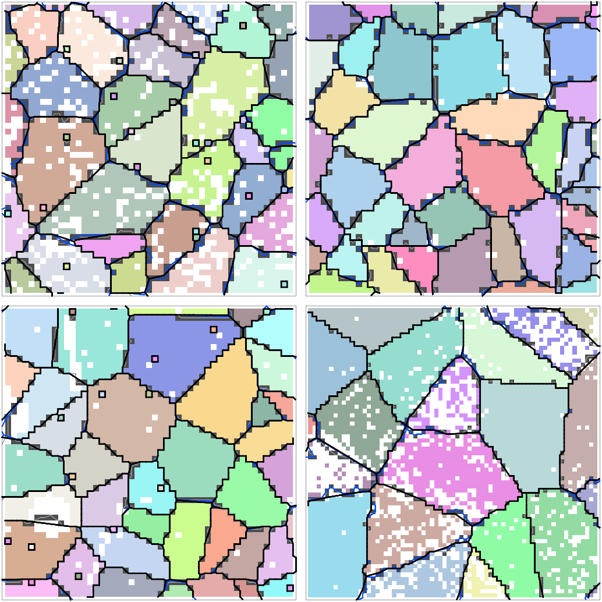
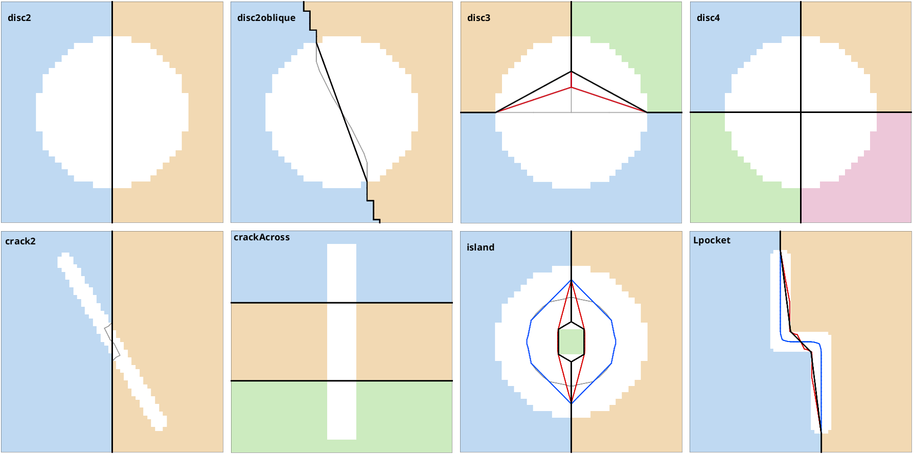
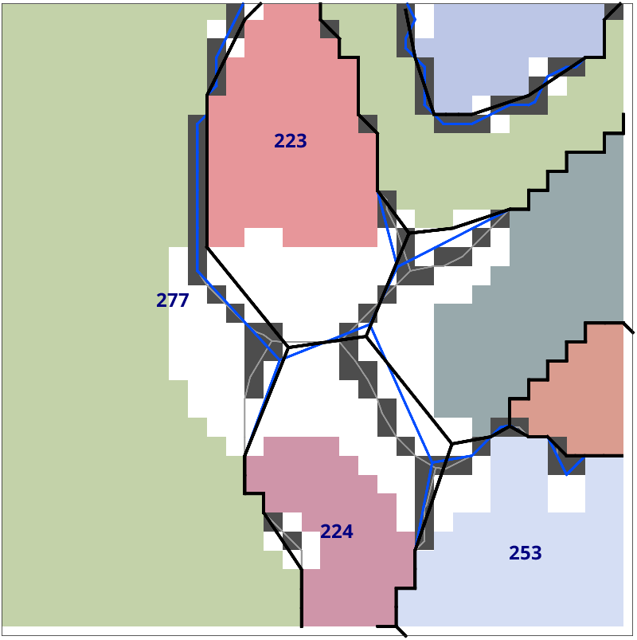
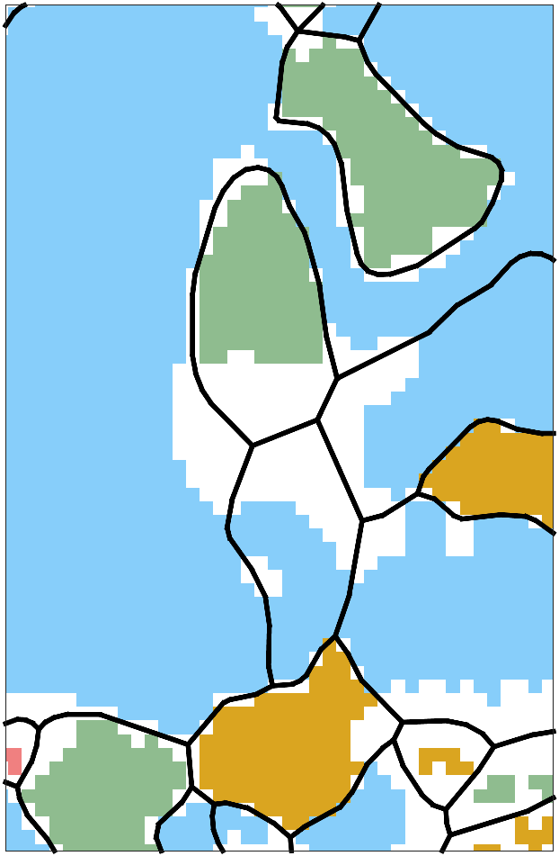
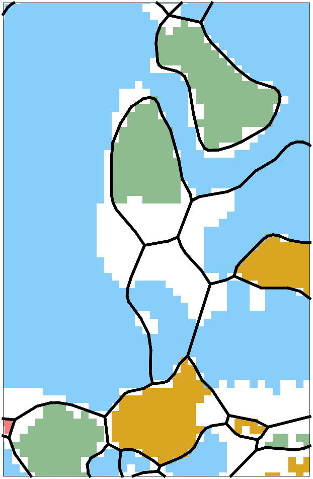
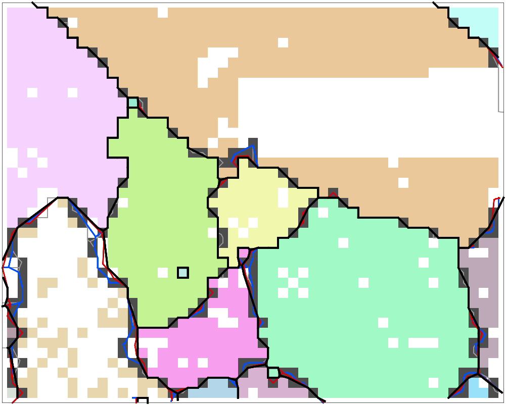
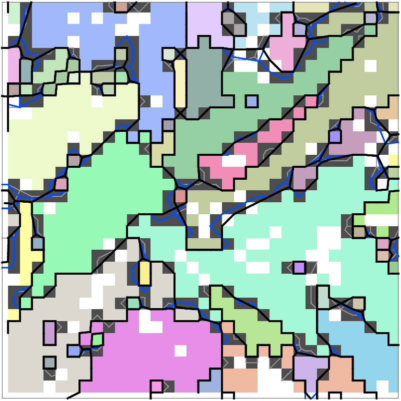

# Shortest grain boundaries through the filled cells

2026-11-11, branch `claude/minboundaryfill-d92780`. The prototype is
`EBSDAnalysis/@EBSD/private/straightenInFill.m` on that branch; `spatialDecompositionGrid` hands it
the fill raster in two new fields of `out`.

## Result

The boundary network inside the filled cells has an exact shortest form, and it can be computed
vectorized at the cost of develop's straightening. The prototype reaches it to within 0.02 % of the
boundary length on every map tested.

| map | develop | taut string | component | exact reference | prototype |
|---|---:|---:|---:|---:|---:|
| forsterite | -3.44 % | -5.90 % | -6.64 % | -9.01 % | -8.99 % |
| peridotite, `minPixel 5` | -2.05 % | -3.58 % | -4.05 % | -5.14 % | -5.13 % |
| peridotite, `alphaPocket 10` | -2.18 % | -3.91 % | -4.59 % | -5.79 % | -5.79 % |
| peridotite, `alphaPocket 10, alphaCrack 15` | -2.38 % | -4.29 % | -5.05 % | -6.34 % | -6.34 % |
| steel 1C_1 | -2.92 % | -5.10 % | | | -8.29 % |

Total boundary length against the bisector boundaries (no straightening). Against develop the
prototype is 5.8 % shorter on forsterite, 3.1 to 4.1 % on peridotite and 5.5 % on 1C_1.

- **Constraints.** No grain gains or loses a measured pixel and the grain counts are those of
  develop (2855, 540, 499, 484, 111 427). On all five maps no moved segment enters a cell that is no
  fill and no two segments cross. The taut string enters such cells by up to 0.085 px in 812
  (forsterite), 206 (peridotite) and 21 435 (1C_1) segments, develop in 16, 10 and 761.
- **Runtime.** `calcGrains` on 1C_1 takes 26.2 s against 21.4 s on develop; the taut string took
  30 s. On forsterite and peridotite it takes 1.1 to 1.8 s, as on develop.
- **A consequence to decide on.** The shortest network gives a small grain little more than its
  measured pixels, see [Small grains](#small-grains). This is what "as short as possible" means, but
  it changes grain areas visibly.

## The problem

The alpha closing fills cells without a measurement. The Voronoi decomposition of the measured
pixels puts the grain boundaries inside these cells on bisectors of pixels far apart. Inside the
union of the filled cells the boundaries form a network:

- **terminals**, where a boundary between two measured cells enters the fill. They are corners of
  the pixel lattice and stay where they are;
- **junctions**, where three or more boundaries meet inside the fill;
- **chains** of segments between two of these.

The network is to be as short as possible while every chain keeps its two ends and passes every
measured, unfilled and exterior cell on the side it does now. Under these constraints the shortest
network is unique:

- every chain is straight between the cell corners it bends around, with the cell on the inside of
  each bend;
- every junction is where the sum of the distances to the first bends of its chains is least. Three
  chains then meet at 120°, unless the junction is pushed against a cell.

What the constraints do not allow is a change of the network itself: a junction of four chains stays
one, and two junctions never swap partners. `disc4` below shows what that costs.

## Methods

| name | what it does |
|---|---|
| develop | one harmonic solve towards straight lines; a segment whose sweep leaves the fill goes back to the bisector with both ends fixed |
| taut string | rounds of harmonic solves; every vertex moves as far as its segments' sweep stays in the fill, the vertex next to the contact is fixed |
| component | the same with one fraction and one fixed vertex per component and round |
| exact reference | loops: triangle shortcuts over the hull of the cell corners for every chain, Fermat point for every junction, Gauss-Seidel until nothing moves. `harness/sif_ref.m` |
| prototype | the same result, vectorized over all chains and junctions, see [The prototype](#the-prototype) |

The first three test the swept area on samples a third of a pixel apart and fix a vertex of the
chain where it touches. That leaves slack next to every contact and lets a segment cut a cell corner
between two samples. They also place a junction by the harmonic solve, which minimises squared
lengths: the result depends on how many vertices each chain has and is not the 120° point.

## Measurements

Straightening alone, on the stored input of each map, R2024b through the bridge. "leave" counts the
moved segments with a sample more than 0.01 px inside a cell that is no fill, "cross" the segments
that properly cross another one.

| map | | develop | taut string | component | exact reference | prototype |
|---|---|---:|---:|---:|---:|---:|
| forsterite | time | 0.31 s | 0.46 s | 1.12 s | 22.3 s | 0.61 s |
| | leave / cross | 16 / 0 | 812 / 0 | 844 / 0 | 0 / 0 | 0 / 0 |
| peridotite | time | 0.20 s | 0.27 s | 0.41 s | 6.4 s | 0.25 s |
| | leave / cross | 10 / 0 | 206 / 0 | 158 / 0 | 0 / 0 | 0 / 0 |
| peridotite, pockets | time | 0.27 s | 0.27 s | 0.60 s | 6.5 s | 0.23 s |
| | leave / cross | 9 / 0 | 183 / 0 | 161 / 0 | 0 / 0 | 0 / 0 |
| peridotite, pockets and crack | time | 0.27 s | 0.26 s | 0.52 s | 6.8 s | 0.26 s |
| | leave / cross | 9 / 0 | 184 / 2 | 161 / 0 | 0 / 0 | 0 / 0 |
| 1C_1 | time | 8.3 s | 16.1 s | | | 11.2 s |
| | leave / cross | 761 / 3 | 21 435 / 18 | | | 0 / 0 |

The component variant was not rerun on 1C_1 (74 s for `calcGrains` in the session before this one),
the reference would take about ten minutes there.

Whole `calcGrains`:

| map | develop | taut string | prototype | pixels outside all grains, develop → prototype |
|---|---:|---:|---:|---:|
| forsterite | 1.07 s | 1.22 s | 1.11 s | 7.3 % → 5.5 % |
| peridotite | 1.09 s | 1.09 s | 1.11 s | 11.0 % → 10.1 % |
| peridotite, pockets | 1.43 s | 1.47 s | 1.38 s | 10.5 % → 9.6 % |
| peridotite, pockets and crack | 1.79 s | 1.79 s | 1.77 s | 8.0 % → 7.1 % |
| 1C_1 | 21.4 s | | 26.2 s | 16.7 % → 12.7 % |

A notIndexed pixel is outside all grains when a boundary runs through its cell. Boundaries that run
along the measured cells cut fewer of them. On peridotite five or six indexed pixels change grain.
They belong to grains `minPixel` culled, which `calcGrains` treats as notIndexed; checked for the
six of the pockets case.

### Benchmark maps

Twelve maps with notIndexed pixels from the "Grain Benchmark Maps" gallery (pymtex
`feature/grainBenchmark`, tiers T0 and T1), threshold 5°, with `'alphaPocket',10,'alphaCrack',10`.
None of the five galleries is titled "compactified"; this one is the contact sheet of the maps
themselves. With the default closing the numbers differ by at most 0.4 points.

| map | develop | taut string | component | exact reference | prototype |
|---|---:|---:|---:|---:|---:|
| T0_07_clusters | -0.53 % | -0.67 % | -0.67 % | -0.89 % | -0.89 % |
| T1_clean_clusters | -0.72 % | -0.75 % | -0.75 % | -0.88 % | -0.87 % |
| T1_noisy_clusters | -1.80 % | -1.95 % | -2.00 % | -2.52 % | -2.50 % |
| T1_clean_cracks | -0.56 % | -0.68 % | -0.69 % | -0.78 % | -0.78 % |
| T1_noisy_cracks | -1.73 % | -2.05 % | -2.12 % | -2.73 % | -2.72 % |
| T1_deformed_cracks | -0.66 % | -0.79 % | -0.79 % | -0.90 % | -0.90 % |
| T1_clean_boundaryNotIndexed | -3.27 % | -4.02 % | -4.36 % | -6.23 % | -6.21 % |
| T1_clean_patchy | -3.56 % | -5.03 % | -5.22 % | -6.47 % | -6.45 % |
| T1_noisy_patchy | -3.17 % | -4.97 % | -5.44 % | -7.27 % | -7.26 % |
| T1_patchyD21 | -4.40 % | -6.44 % | -6.71 % | -8.03 % | -8.02 % |
| T1_clean_matrix | -0.10 % | -0.10 % | -0.10 % | -0.10 % | -0.10 % |
| T1_noisy_matrix | -1.15 % | -1.25 % | -1.25 % | -1.63 % | -1.62 % |

Every variant takes 0.01 to 0.2 s on these maps, the reference up to 3.9 s. The prototype has no
segment leaving the fill and none crossing; the taut string leaves the fill in up to 138 segments.

T1_noisy_patchy, T1_clean_boundaryNotIndexed, T1_noisy_cracks, T1_patchyD21. Grey the bisectors,
blue develop, black the prototype; white cells are filled and inside one grain, dark cells are cut
by a boundary.

### Synthetic maps

`harness/fillTestMap.m` cuts one hole into a 96 × 96 map of two to four grains with straight
boundaries. Total boundary length in pixels, the outer boundary of 384 included; the minimum is the
analytic one.

| map | hole | bisector | develop | taut string | component | reference | prototype | minimum |
|---|---|---:|---:|---:|---:|---:|---:|---:|
| disc2 | disc, radius 12, on a straight boundary | 480.000 | 480.000 | 480.000 | 480.000 | 480.000 | 480.000 | 480.000 |
| disc2oblique | the same, boundary of slope 3 | 505.938 | 505.409 | 505.409 | 505.409 | 505.409 | 505.409 | 505.409 |
| disc3 | disc on a T junction | 528.000 | 525.300 | 525.300 | 525.300 | 524.785 | 524.794 | 524.785 |
| disc3, radius 30 | | 528.000 | 521.250 | 521.250 | 521.250 | 519.962 | 519.985 | 519.962 |
| disc4 | disc on a quadruple point | 576.000 | 576.000 | 576.000 | 576.000 | 576.000 | 576.000 | 574.364 |
| crack2 | band 4 × 48 px, 30° off a straight boundary | 483.187 | 480.000 | 480.000 | 480.000 | 480.000 | 480.000 | 480.000 |
| crackAcross | band 12 px wide across two boundaries | 576.000 | 576.000 | 576.000 | 576.000 | 576.000 | 576.000 | 576.000 |
| island | disc with a measured 4 × 4 block of a third grain | 510.455 | 510.332 | 500.573 | 500.575 | 490.928 | 490.929 | 490.928 |
| island, radius 30 | | 548.937 | 550.593 | 533.246 | 533.209 | 490.928 | 490.929 | 490.928 |
| Lpocket | L-shaped pocket along a boundary with a step | 489.941 | 489.941 | 483.852 | 483.050 | 482.859 | 482.859 | |
| Lpocket, radius 30 | | 501.946 | 500.562 | 484.772 | 483.215 | 482.730 | 482.753 | |

- **Where all agree.** A boundary that can be straight between its two terminals is straight in
  every variant.
- **Junctions.** On the T junction only the reference and the prototype find the Steiner point; the
  harmonic junction of the others is 0.5 px (radius 12) and 1.3 px (radius 30) too long.
- **Bends.** The boundary around the island is the hexagon of the minimum only in the reference and
  the prototype. Develop's is longer than the bisectors at radius 30, because it fixes vertices on
  the bisector where the first straight attempt failed.
- **The limit of a fixed network.** On the quadruple point every variant keeps one junction of four
  chains, 576.000. Two triple junctions would give 574.364, 0.28 % less.

Grey the bisectors, blue develop, red the taut string, black the prototype.

## The crack example

`doc/Grains/GrainReconstructionCracks.m`, `grainsP` with `'alphaPocket',10`. Grains 223 and 224 sit
in a filled pocket of grain 277. The window x 14 500 to 16 500, y 6 400 to 8 400 µm holds 8 730 µm
of boundary on the bisectors, 8 633 µm on develop and 8 365 µm with the prototype.

Grey the bisectors, blue develop, black the prototype, before `smoothBoundary`.

Three things make develop's boundaries longer than necessary here:

- **Junctions off the 120° point.** The two junctions between 223 and 224 have the angles
  111° / 132° / 117° and 130° / 93° / 137° on develop. The prototype has 121° / 120° / 119° and
  119° / 120° / 121°.
- **Vertices fixed on the bisector.** Left of 223 the straight line from the top to the junction
  would cut the pixels of 223, so develop puts the whole piece back: the boundary runs up the middle
  of the one cell wide notIndexed column and down the staircase of bisector pieces. The shortest
  boundary runs along the pixels of 223, turns at their lower left corner and goes straight to the
  junction.
- **The same on the right**, between 223, 224 and grain 313: develop's chains keep the kinks of the
  bisectors where a straight piece touched a cell.

The page shows the boundaries after `smoothBoundary`, where the differences are smaller but remain:

| develop | prototype |
|---|---|
|  |  |

The page runs in 10 s with the prototype and prints 540 / 499 / 484 grains with 34 / 2 / 2
notIndexed ones, and 10.1 % / 9.6 % / 7.1 % of the map outside all grains.

Forsterite, x 11 000 to 13 500, y 4 000 to 6 000 µm, with the taut string in red.

Steel 1C_1, x 84.6 to 89.6, y 4.6 to 9.6 µm.

## Small grains

A grain of a few measured pixels inside a pocket has a boundary that can shrink until it runs along
its pixels, and the shortest network does exactly that. Polygon area over measured area, indexed
grains by number of measured pixels:

| measured pixels | forsterite: bisector | develop | prototype | peridotite, pockets: bisector | develop | prototype |
|---|---:|---:|---:|---:|---:|---:|
| below 10 | 1.74 | 1.66 | 1.32 | 1.97 | 1.89 | 1.41 |
| 10 to 30 | 1.66 | 1.67 | 1.62 | 1.71 | 1.65 | 1.42 |
| 30 to 100 | 1.55 | 1.55 | 1.56 | 1.46 | 1.45 | 1.41 |
| 100 to 300 | 1.37 | 1.38 | 1.39 | 1.28 | 1.29 | 1.30 |
| above 300 | 1.24 | 1.24 | 1.25 | 1.13 | 1.13 | 1.14 |

The fill a small grain gives up goes to its large neighbours. For an isotropic boundary energy that
is the right answer, and it is the same mechanism by which a small grain vanishes in grain growth.
If the fill should instead be shared in proportion to something, that is a different objective.

## The prototype

`straightenInFill` keeps its interface. `spatialDecompositionGrid` adds `out.fill`, the filled
cells as a mask over its raster, and `out.cell2pos`, the position of a raster cell.

1. **Cut.** The boundary segments get a vertex where they enter the fill, as on develop.
2. **Network.** The segments with an end inside the fill are walked from node to node, all chains
   at once. Each chain becomes a polyline of points in lattice coordinates, where every cell is the
   Voronoi cell of an integer point.
3. **Tighten.** A point of a polyline is replaced by the hull of the corners of the cells that are
   no fill inside the triangle of the point and its two neighbours: by nothing if there is none, by
   itself if it already sits on the only corner. Points that are no neighbours are done in one pass,
   the hulls by a quickhull over all triangles at once. The passes end when every point wraps a
   corner.
4. **Junctions.** One sparse solve moves all junctions to the minimum of the squared lengths of
   their first segments, each weighted by the inverse of its present length. Repeated, this
   converges to the minimum of the lengths. A junction moves as far as the fill reaches and then
   along the side of the cell that blocks it. Where the end of a chain sweeps over a cell that is no
   fill, the old place of the junction stays as a point of the chain, and step 3 pulls it tight.
5. **Stop** when a round gains less than 0.05 % of the network length, after ten rounds at the
   latest. A last round puts junctions closer than a tenth of a pixel onto one point, so that a
   junction which overshot its neighbour leaves no crossing.
6. **Write back.** The vertices of every chain are spread evenly over its straight pieces, one on
   every bend. A chain with more bends than vertices gets the missing vertices on its last segment.

On 1C_1, with 515 000 free vertices and 149 000 junctions, the cut takes 2.3 s, the first
tightening 1.3 s, seven junction rounds about 0.7 s each and the write back 0.5 s. Before the first
six rounds the network is 6.4 %, 1.6 %, 0.7 %, 0.4 %, 0.2 % and 0.1 % longer than after ten.

The file has 519 lines against 196 on develop; the sampling of the swept area, the crossing test
and its buckets are gone.

## Open points

- **`simplify` and `check_boundaryChains` section 13.** On `small`, `simplify` keeps 461, 377, 332,
  285 and then 325 segments for the five tolerances of the test, so "coarser as the tolerance grows"
  fails at the last step, as it does with the taut string (292, then 321). On develop the counts are
  542, 405, 343, 307, 293. Chains that run along the same cells lie close together, and `simplify`
  gives back the chords that would cross. The other properties I probed on that map hold: 75 grains,
  97 junctions, 67 triple points, 22 closed chains, 168 chains, the grain pair constant along a
  chain, `grainId(:,1)` on the left of all 188 pixel edges, no zero length segment, every pixel
  centre inside its grain after `smoothBoundary`.
- **Tests not run.** `check_boundaryChains`, `check_calcGrainsCases` and the core tier need Ralf's
  go. The numbers above come from my own probes.
- **Distorted lattices.** On `small` with the 2 % trapezoid of `check_calcGrainsCases` the cells of
  the lattice model and the Voronoi cells of the measured pixels differ by a few hundredths of a
  pixel. The prototype then enters a measured cell by up to 0.03 px in 9 segments and 6 segments
  cross at a chain end. On rigid square and hexagonal lattices (titanium with about a third of the
  pixels set notIndexed) there is neither.
- **The network is fixed.** A quadruple point is not split into two triple junctions and two
  junctions do not swap partners, see `disc4`. Both would shorten the network further and change
  which grains are neighbours inside a pocket.
- **The cut** still finds the fill entries by bisection on samples. They are lattice corners, so the
  prototype puts every node on the fill edge onto the corner next to it. An exact cut would remove
  the 2.3 s of sampling on 1C_1.
- **pymtex.** `mtex/maps/straighten.py` mirrors develop's algorithm and is not touched.
- **`smoothBoundary`** moves the vertices away from the minimum again. Whether it should keep the
  vertices that sit on a cell corner was not looked at.

## Reproducing

`fill-boundary-minimization/harness/` holds the scratch code of this investigation, unpolished:

- `sif_ref.m` is the exact reference, `sif_none.m` the bisectors, `sif_new.m` calls the tree's
  `straightenInFill`. Develop's version and the taut string are the files of `develop` and of the
  worktree `tautString`, with the function renamed to `sif_dev` and `sif_ts`.
- The variants are selected by a hook that is not committed, as the first lines of
  `straightenInFill`: `global SIF`, then
  `if ~isempty(SIF), [V,F,I_FD,V0] = feval(SIF,V,F,I_FD,grainId,out); return; end`.
- `sif_dump.m` keeps the input of the straightening of one `calcGrains` call, `sifEval.m` runs
  variants on it and reports length, time, crossings and segments leaving the fill.
- `fillTestMap.m` and `runSynth.m` are the synthetic maps, `loadBenchMap.m`, `runBench.m` and
  `benchTable.m` the benchmark maps. Their `.mat` files are written by `export_bench_mat.py` from
  the stored instances of the pymtex worktree `pymtex-grainBenchmark` and are not in the repository.
